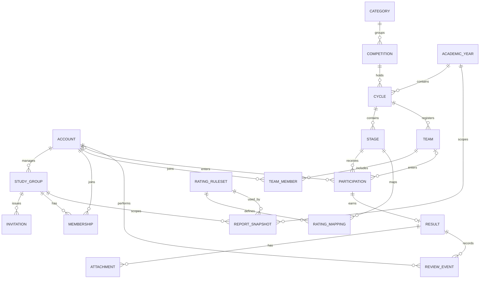

# Архітектура

## Поточна збірка

React, TypeScript і Vite формують один пакет інтерфейсу. Tauri 2 відкриває його в WebView2 з локальних ресурсів. Для перевірки в браузері працює той самий інтерфейс. Стани екранів ґрунтуються на статичних демоданих.

Django має один маршрут `GET /api/health/`. Він повертає ідентифікатор сервісу, статус і версію. У 0.1.0 база не потрібна. Клієнт відхиляє помилковий HTTP-статус, невідому відповідь і запит довший за 3,5 секунди. Повторна перевірка доступна в налаштуваннях. Запит не використовує облікові дані.

Сервер демонстрації слухає loopback. CORS для маршруту дозволяє локальний Vite, локальний preview і штатний origin Windows WebView2. Політика CSP в упакованій програмі дозволяє мережевий запит лише до локального API. Для зміни адреси упакованого API потрібно узгодити Vite, CSP і дозволені origins сервера. У поточній збірці немає нативних команд, плагінів або виданих дозволів Tauri.

## Цільова структура

Центральний Django і Django REST Framework залишаються одним застосунком із модулями `accounts`, `groups`, `competitions`, `achievements`, `attachments`, `ratings` та `analytics`. PostgreSQL зберігає записи, а приватне файлове сховище — дипломи. Сервер перевіряє доступ до групи, запису й файла під час кожної операції. Його розгортає адміністратор, а інсталятор учителя містить налаштовану адресу.

Сайт учня й Windows-програма використовують спільні UI-компоненти й API-клієнт. Desktop зберігатиме токени в захищеному сховищі ОС. Програма передаватиме локальному адаптеру аналізу лише потрібні перевірені агрегати. Учнівський сайт звертається до центрального API. Локальний процес доступний тільки програмі вчителя й не бере участі в прийманні учнівських заявок.

## Логічна схема даних

Схема є проєктом для майбутніх міграцій.

| Сутності | Поля та обмеження |
|---|---|
| Обліковий запис, група, членство, запрошення | Роль і стан облікового запису, учитель групи, назва групи, стан членства, дата підтвердження. Один запис членства на пару учень–група. Запрошення містить геш коду, строк дії та стан відкликання. |
| Категорія, конкурс, річний цикл, етап | Редаговані назви, належність конкурсу до категорії, навчальний рік і межі циклу, ідентифікатор етапу та його відображувана назва. Юніорський і дівочий конкурси мають окремі записи в спільній початковій категорії. |
| Навчальний рік | Назва, початок включно й кінець виключно. Межі задаються явно, а рік для результату визначає цикл. |
| Команда, учасник, участь | Команда належить циклу. Участь має рівно одного власника — учня або команду того ж циклу. Одна участь на пару власник–етап. Підтверджена командна участь фіксує список учасників, використаний для рейтингу. |
| Результат, вкладення, подія модерації | Результат зберігає оригінальні місце, нагороду або бали, статус і версію запису. Вкладення містить приватний ключ файла, перевірений MIME-тип, розмір і назву для показу. Подія фіксує автора, час, причину та попередні й нові значення. Зміна результату й запис події відбуваються в одній транзакції. |
| Версія правил, зіставлення, знімок звіту | Незмінна опублікована версія правил і таблиця зіставлень рівня та типу нагороди. Знімок містить період, групу, версію правил, дату розрахунку, внески та ідентифікатори джерел. |

Стартові категорії — інформатика, МАН, штучний інтелект, юніорські й дівочі олімпіади, ICPC та Олімпіада геніїв. Правила конкретного конкурсу вносяться в довідник після погодження з учителем.

## Розрахунки та аналіз

Пропоновані бали рівнів — 10, 25, 50 і 100 від локального до міжнародного. Для участі, III, II та I місць початкові множники становлять 1, 1,5, 2 і 3. Правила застосовуються до підтверджених і явно зіставлених результатів. Індекс за рік бере максимум у межах циклу, потім максимум у кожній категорії та додає внески категорій із вагами, що початково дорівнюють одиниці. За рівності індексів місце спільне. Командна нагорода рахується один раз у груповій статистиці, а підтвердженим учасникам можна зарахувати індивідуальні внески.

Відкликання підтвердження оновлює поточний розрахунок. Історичний знімок залишається з вихідною версією правил і датою. Портфоліо зберігає всі дозволені записи, а відсутність підтверджених даних має окреме пояснення.

Адаптер локальної моделі працюватиме з одним активним запитом і аспектом за раз. Очікувані поля — `observation`, `evidence_ids`, `limitations` і `suggested_question`. Перед показом серверні агрегати й джерела звіряються з твердженнями моделі. Ключ кешу враховує версії даних, правил, моделі та промпту. Опис запису або документа обробляється як вхідні дані. У разі помилки доступний звичайний звіт. Вимоги до пам’яті й точну конфігурацію runtime потрібно підтвердити замірами на цільових ПК.
